# Hoard Hopper

*A little dragon with big ambitions.*

Hop through four scrolling caves, scoop up every coin, gem and crown you can reach, dodge the lava, spikes and falling rocks, then fly home and pile it all onto your hoard. Rest on your gold for as long as you like. Every trip makes the pile a little more magnificent.

**[▶ Play Hoard Hopper](https://hoardhopper.synapticnoise.com)** in your browser. No install, works on desktop and on phones (held sideways).

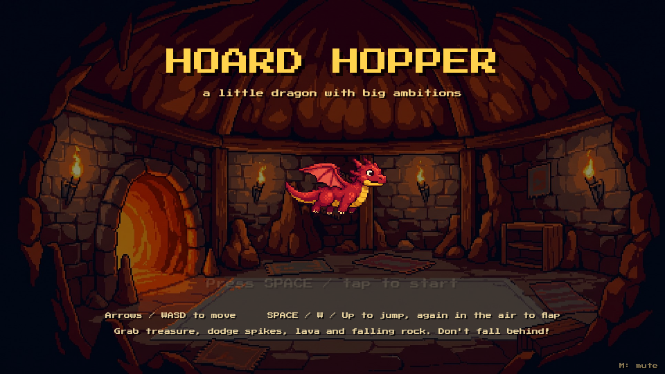

## The caves

| | |
|---|---|
| 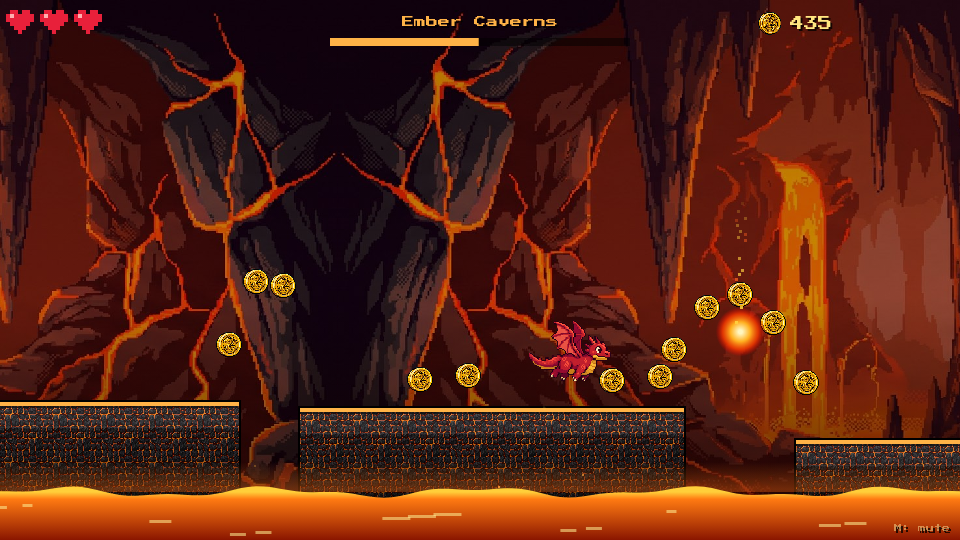 **Ember Caverns.** Lava falls and leaping fireballs. | 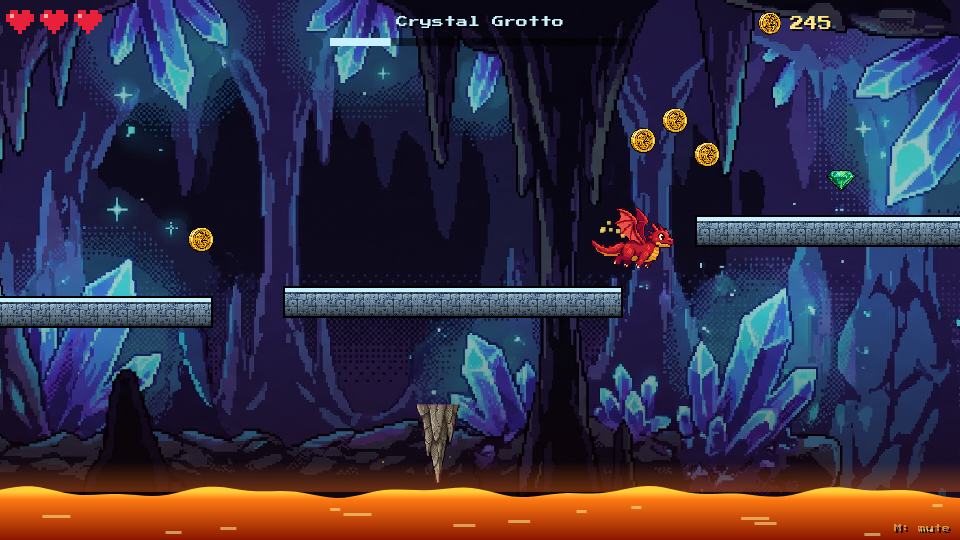 **Crystal Grotto.** Glittering gems and rocks that drop from the ceiling. |
| 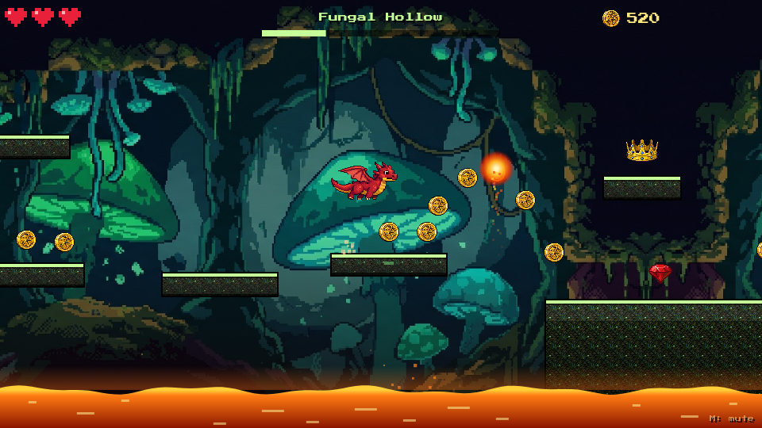 **Fungal Hollow.** Glowing mushrooms and moving ledges. | 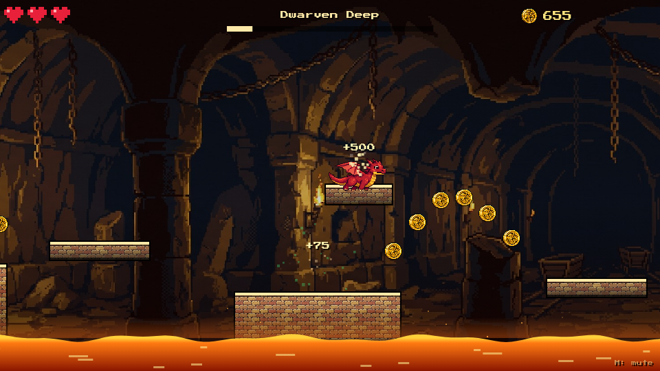 **Dwarven Deep.** Ancient halls with the richest treasure and the toughest hops. |

Each cave scrolls a little faster and hides better loot than the last. Finish all four and you head back in, one level deeper, where the caves get harder and the treasure keeps coming.

## The hoard

At the end of every cave, your dragon flies home and stashes the haul. The pile grows from *A Modest Stash* all the way to *A Legendary Hoard*, and keeps swelling after that. Your hoard is saved in your browser, so it's waiting for you next time.

| Stashing the haul | A legendary hoard |
|---|---|
| 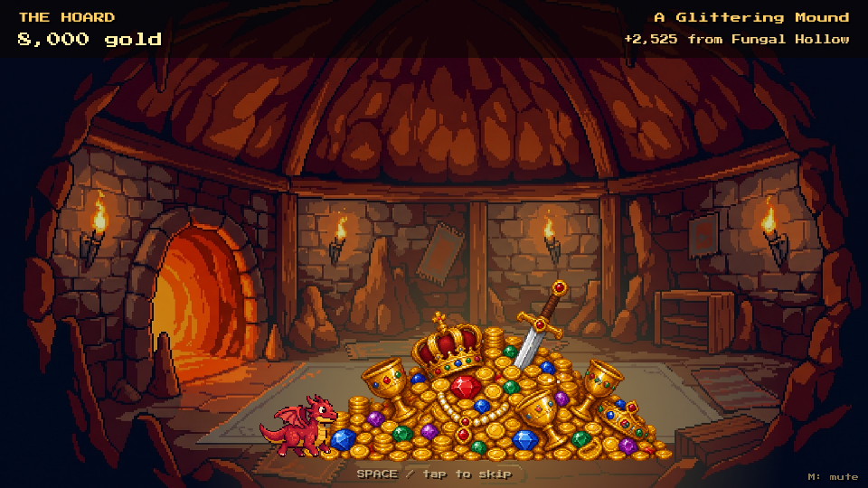 | 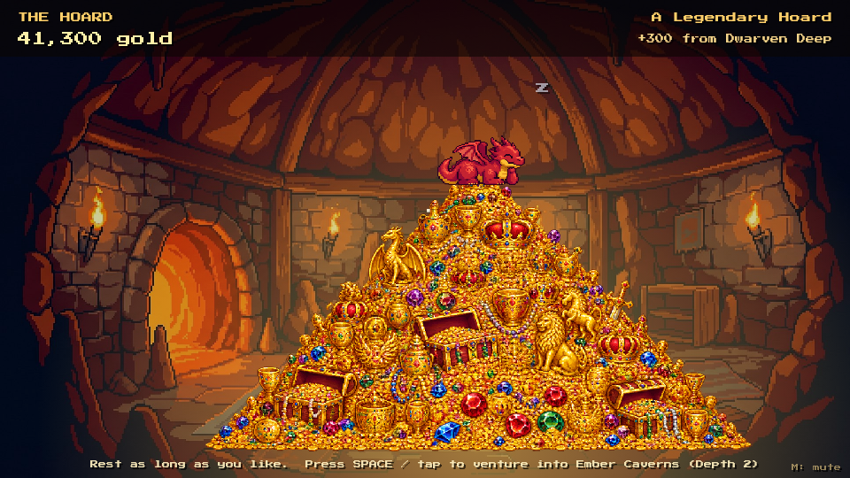 |

## How to play

- **Move:** arrow keys or A / D
- **Jump:** Space, W or Up. Press it again in the air to flap your wings for a little extra lift.
- **Mute:** M
- On a phone, use the on-screen buttons. On Android you can install it from Chrome's menu (**Install app**) to play full screen, even offline.

You have three hearts per cave. Getting hurt shakes a little treasure loose, and if you run out of hearts you'll try that cave again. Don't worry: the hoard back home is always safe.

## How it was made

Hoard Hopper was made by [Claude Code](https://claude.com/claude-code). Every picture, animation, song and sound effect was generated with four Claude Code plugins, starting from this one request:

> Can you test each skill. Make a dragon with a transparent background, a dragon flying, and a dragon roaring sound, and a pixel dragon that hops through platforms in a continuously scrolling cave. He can gather treasure on some platfoms and there's probably lava and spikes and at the end of each level he stashes what he gathered to build a pile of gold. He can lay in it for as long as he likes before startig the next level. The pile of gold/treasure should get impressive over time. The level should have music and there should be at least 3-4 caves. Make the graphics and sound and whatnot and let me know when it's playable. Serve the page locally but keep in mind we'll probably serve it via GitHub pages or something. Assume it's fine to use $20 of budget across the keys. Report when I try it.

Partway through, one follow-up asked Claude to make sure every cave was fully playable: harder as you go, with better treasure, but never too frustrating. Claude Code planned the game, wrote the code, generated and reviewed the art and audio, and play-tested every cave before calling it done.

Here's what each plugin did.

### [nanogen](https://github.com/zeveck/nanogen): the world

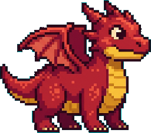

nanogen creates images with Google's Gemini (Nano Banana). It designed the little red dragon himself, then painted all four cave backdrops and the cozy lair, the rock and brick textures for the platforms, and every coin, gem, goblet, crown, chest, spike and stalactite.

<br clear="right">

### [imagegen2](https://github.com/zeveck/imagegen2): the gold

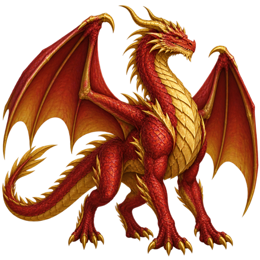

imagegen2 creates images with OpenAI's GPT Image. It made the five stages of the treasure hoard, from a few scattered coins to a towering mountain of gold. It also drew the majestic dragon on the right, the very first test of the session, and every animation frame described below.

<br clear="right">

### [anim8gen](https://github.com/zeveck/anim8gen): the motion

<p>
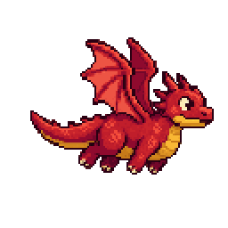
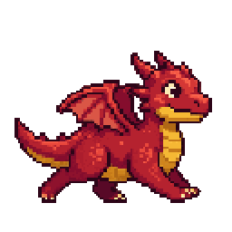
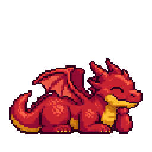
</p>

anim8gen turns a character into short sprite animations. Starting from nanogen's dragon, it had imagegen2 draw each pose, checked every frame to keep the dragon looking like himself, and lined the frames up into smooth loops: flapping his wings, trotting along the ledges, and snoozing happily on his gold.

### [audiogen](https://github.com/zeveck/audiogen): the sound

audiogen creates audio with ElevenLabs. It composed a theme for each cave and a lullaby for the lair, plus every sound in the game: jumps, wing flaps, coin chimes, gem sparkles, lava hisses, the pour of treasure onto the pile, a sleepy dragon purr, and one big **[dragon roar](media/showcase/dragon-roar.mp3)**.

## Playing locally

Hoard Hopper is a plain web page with no build step. Serve the `game` folder with any static web server, for example:

```sh
python3 -m http.server --directory game
```

Then open http://localhost:8000.
